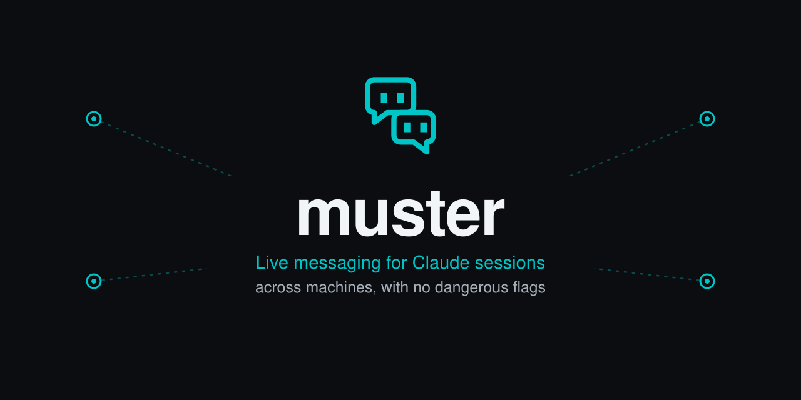

<p align="center">
  
</p>

Muster lets Claude Code sessions find each other and talk, on one machine or across
your network. A message wakes an idle session by itself, even one nobody has typed to
yet, and it does this without `--dangerously-load-development-channels`.

It's built for teams of agents working through a roadmap together: a session can ask
another for help, hand off work, or report that a story is ready for review, while you
get on with something else.

- **Live, with no flag.** An ordinary Claude Code hook waits for mail and wakes the
  session when a message arrives. It uses no model turns while waiting.
- **Across machines.** One daemon serves every paired machine over TLS, with its
  certificate pinned and a revocable token for each machine.
- **Durable.** With Postgres, messages and the roster survive a daemon restart. Messages
  to a session that has ended are eventually deleted with it.
- **Built on [myko](https://crates.io/crates/myko), in Rust.** New code is Rust. Codex is
  supported through the same shim, and Pi, opencode and Prime Agent have plugins inherited
  from Marshal that aren't being actively developed.

> [!IMPORTANT]
> **Muster is young, and you should only pair machines you trust.** It's designed for
> one operator's own machines on a private network, or over Tailscale or WireGuard, not
> the open internet. A paired machine can no longer read, clear or send as another machine's
> session, in tests, but the check is a filter over myko's parser, it hasn't been attacked on
> a live daemon, and the roster stays readable by every paired machine (see
> [docs/session-binding.md](docs/session-binding.md)). A message's sender also can't prove a
> human wrote it, so don't treat one as approval. The wake hook also relies on
> `asyncRewake` working before a session's first prompt, which Claude Code doesn't document,
> so check it after upgrades.

**Status (2026-10-31): early alpha, best guess.** Running day to day between two machines,
one macOS and one Linux. An overnight idle wake isn't proved yet (MUS-1), and it hasn't been
installed on a clean machine, or run on Windows beyond a cross-compile. 6 of 43 roadmap
stories are verified, about 14%.

See the [roadmap](docs/roadmap.md) for where this is heading and
[the board](docs/board.md) for how the teams work together.

Muster is a fork of [Marshal](https://github.com/ignition-is-go/marshal) by
ignition-is-go, used under its MIT OR Apache-2.0 licence, and it can run side by side with
Marshal: it has its own binaries (`muster-shim`, `muster-daemon`), ports (6255 to 6257),
`MUSTER_*` variables and `~/.config/muster`. Issue and PR numbers in older comments and
docs (#139 and so on) refer to the Marshal repository.

## Install

Install the binaries, run the daemon, then wire the harnesses you use.

### 1. Install the binaries

Muster isn't published to crates.io; install from the repository (or from a
local checkout with `--path crates/shim` and so on):

```bash
cargo install --git https://github.com/Castor-o7/muster muster-shim muster-daemon
# optional but recommended for visibility into the live roster
cargo install --git https://github.com/Castor-o7/muster muster-tui
```

This puts `muster-shim` and `muster-daemon` on your `PATH` (typically `~/.cargo/bin`).

### 2. Start the daemon

The daemon runs out-of-band — one daemon that every session's shim connects to (on the same machine, or reachable over the network), lifetime independent of any Claude Code session. Pick whichever fits:

```bash
# foreground in its own terminal
muster-daemon

# or backgrounded under your shell job control
muster-daemon &

# or under your favorite supervisor (systemd user unit, launchd, tmux pane, ...)
```

The daemon has three listeners. Only the gate is meant to be reachable from other machines:

| Port | Variable | Default | Serves |
|---|---|---|---|
| 6255 | `MUSTER_BIND` | `127.0.0.1:6255` | **The gate**: TLS plus a per-machine access token, in front of the two below |
| 6257 | `MUSTER_INTERNAL_BIND` | `127.0.0.1:6257` | myko's WebSocket/MCP listener (no TLS or auth; keep it on loopback) |
| 6256 | `MUSTER_HOOK_BIND` | `127.0.0.1:6256` | The plain-HTTP hook listener (no TLS or auth; keep it on loopback) |

To accept sessions from other machines, set `MUSTER_BIND=0.0.0.0:6255` (or a LAN/mesh address) and pair each machine (below). Tools running on the daemon's own host, like the TUI and the web UI, can still connect to `ws://127.0.0.1:6257` directly.

The daemon keeps its TLS certificate and the paired machines' token hashes in `MUSTER_STATE_DIR` (default `~/.local/state/muster`). Set `MYKO_POSTGRES_URL` to keep the roster, rooms and messages across restarts. Without it the daemon runs in memory and starts empty each time.

### 2b. Pair each machine

Every machine other than the daemon's own host needs a pairing. (On the daemon's host, an unpaired shim connects to the internal loopback listener on 6257, so it works without one. Pair it too if other people can log in to that machine.) On the daemon's host:

```bash
muster-daemon pair --name a1 --address 192.168.1.241:6255
```

It prints a `muster-shim pair muster-pair:v1:…` command. Run that on the machine you're pairing. The code holds the gate's address, the certificate fingerprint to pin, and that machine's access token, so treat it like a password. Then restart that machine's Claude Code sessions.

- `--address` is how the paired machine should reach the gate. It can be left out when `MUSTER_BIND` is a specific address rather than `0.0.0.0`.
- `muster-daemon pairs` lists paired machines, and `muster-daemon unpair a1` revokes one. Its open connections close within seconds and new ones are refused; nothing needs restarting.
- `muster-shim unpair` removes a machine's own pairing.
- Pairing again under the same name replaces that machine's token.
- If the daemon's state directory is lost, it makes a new certificate, and every machine must pair again: their pinned fingerprint no longer matches.

A paired shim never sends anything unencrypted. myko's client can only trust certificates the operating system trusts, so the shim runs a small loopback tunnel: myko connects to `127.0.0.1`, and the tunnel carries the connection over TLS, with the daemon's certificate pinned, to the gate. The hooks make the same pinned TLS connection themselves. Codex, Pi, opencode and Prime Agent clients don't support pairing yet.

### 2c. Message the muster from a terminal

From any terminal on a paired machine, or on the daemon's own host, outside a Claude session:

```bash
muster-shim all "Full agenda today, please send your status."
muster-shim tell catapp "Please pause before the next migration."
```

`all` reaches every session on the roster, and `tell` takes a team name, nickname or session id. Each session gets a direct message, which wakes it if idle, and you get one line per session. An unknown or ambiguous name is refused. The exit status is non-zero if anything wasn't sent.

Recipients see `[from a terminal on <machine>; it can't receive replies]`. That names the machine, not the person: any process on your account can run this command, including a Claude session, so these messages carry no extra authority.

A message from `all` or `tell` is never the operator's approval. It doesn't count as a direct OK for a daemon restart or anything else that needs one, because a session can send the same message.

### 3. Add the plugin in Claude Code

```text
/plugin marketplace add Castor-o7/muster
/plugin install muster-shim@muster
```

Restart the session. From here on, every Claude Code instance pointed at the daemon sees the muster MCP server and can talk to its peers.

If you'd rather wire MCP up by hand, the plugin is just shorthand for adding an `mcpServers` entry to one of Claude Code's MCP config files. Pick the scope that fits:

**Project scope** — write a `.mcp.json` at the repo root (commit it to share with collaborators):

```json
{
  "mcpServers": {
    "muster": { "command": "muster-shim" }
  }
}
```

**User scope** — applies to every Claude Code session for your user. Add a top-level `mcpServers` entry to `~/.claude.json`:

```json
{
  "mcpServers": {
    "muster": { "command": "muster-shim" }
  }
}
```

Or let the CLI do it for you:

```bash
claude mcp add -s user muster muster-shim
```

> Note: `mcpServers` is **not** a supported key in `~/.claude/settings.json` — adding it there silently does nothing. It must live in `.mcp.json` (project) or `~/.claude.json` (user).

### 4. How messages reach Claude Code

Muster delivers direct messages through Claude Code **hooks**; no launch flag is needed. The plugin's `hooks/hooks.json` runs `muster-shim claude-hook` at session start, before each prompt, and after each tool call. Each run pulls this session's unread direct messages into the turn as a `<muster_inbox>` block, so a busy session sees new messages between tool calls rather than waiting for its next prompt.

An idle session wakes by itself, even if nobody has typed to it yet. `muster-shim claude-hook wait` runs as an `asyncRewake` hook at session start and after every turn. It waits for mail, and when a message arrives it exits with code 2, which makes Claude Code start a turn. It uses no model turns while waiting, and it exits when its session does.

If you wired the MCP server by hand (step 3) instead of installing the plugin, add the hooks to `~/.claude/settings.json` yourself:

```json
{
  "hooks": {
    "SessionStart": [
      { "hooks": [
        { "type": "command", "command": "muster-shim claude-hook session-start", "timeout": 10 },
        { "type": "command", "command": "muster-shim claude-hook wait", "asyncRewake": true, "timeout": 2592000 }
      ] }
    ],
    "Stop": [
      { "hooks": [{ "type": "command", "command": "muster-shim claude-hook wait", "asyncRewake": true, "timeout": 2592000 }] }
    ],
    "UserPromptSubmit": [
      { "hooks": [{ "type": "command", "command": "muster-shim claude-hook prompt-submit", "timeout": 10 }] }
    ],
    "PostToolUse": [
      { "hooks": [{ "type": "command", "command": "muster-shim claude-hook post-tool-use", "timeout": 10 }] }
    ]
  }
}
```

The hooks find the daemon from this machine's pairing (step 2b), the same way the shim does. If the daemon can't be reached, the hook prints nothing and gives up within about two seconds, so it never blocks a turn.

#### The channels flag

You don't need `--dangerously-load-development-channels`, and we don't recommend it: the
hooks above already wake idle sessions. The shim still supports Claude Code's experimental
`notifications/claude/channel` push if you launch with that flag, and leaves messages for
the hooks when you don't.

### Pi: native extension

Pi, Prime Agent and opencode connect over plain WebSocket, so they need to run on the daemon's own host, using `ws://localhost:6257`. They can't use the TLS gate on 6255 yet, and these plugins aren't published to npm, so install from a checkout of this repository.

After starting a reachable daemon, install the published
[`muster-pi`](plugins/muster-pi)
package:

```bash
pi install ./plugins/muster-pi
```

Restart Pi. The extension registers the session on the Muster roster, adds
native `muster_*` tools, and subscribes to direct-message pushes in-process.
Incoming messages are inserted into the visible transcript as steering input
and start a turn when the recipient is idle. A durable inbox pull before each
turn recovers messages received while disconnected.

No MCP shim or launcher wrapper is required. The default address is `ws://localhost:6257`. To set it explicitly:

```bash
export MUSTER_DAEMON_ADDRESS=ws://localhost:6257
pi
```

Use `/muster-status` in Pi to verify the connection. See
[`plugins/muster-pi/README.md`](plugins/muster-pi/README.md) for the complete
tool, configuration, and development reference.

### Prime Agent: live conversation bridge

Install the Prime Agent extension package after starting a reachable daemon:

```bash
prime-agent package install ./plugins/muster-prime-agent
```

Restart Prime Agent. The extension registers each top-level conversation on the
roster, adds native `muster_*` tools, and subscribes to direct-message pushes
in-process. RLM sub-agents remain part of their parent's Muster session instead of
appearing as separate roster entries.
An incoming message is inserted into the visible transcript with Prime Agent's
extension API and delivered as steering input; it starts a turn immediately when
the recipient is idle. Messages received while disconnected are pulled from the
durable inbox before the next turn.

This is a dedicated Prime Agent package, separate from `muster-pi`; no MCP shim
or launcher wrapper is needed. The default address is `ws://localhost:6257`. To set it explicitly:

```bash
export MUSTER_DAEMON_ADDRESS=ws://localhost:6257
prime-agent
```

Use `/muster-status` in Prime Agent to verify the connection. See
[`plugins/muster-prime-agent/README.md`](plugins/muster-prime-agent/README.md) for tools,
development loading, and delivery details.

### Codex: local setup without Ansible

These steps give a laptop, workstation, or manually managed VM the same
Muster behavior as an infrastructure-managed host. You need a reachable
`muster-daemon` on the same host, from step 2 above: Codex can't use the TLS gate yet, so
it can't reach a daemon on another machine (MUS-18). Install the Codex CLI itself first and confirm that `codex`
is on `PATH`.

#### 1. Install and wire the shim

Build `muster-shim` from source, then run setup. It adds the Muster MCP server and
lifecycle hooks to `~/.codex/config.toml`, seeds the coordination instructions in
`~/.codex/AGENTS.md`, and pre-trusts the hooks. This fork doesn't publish release
binaries yet (MUS-14). Setup is idempotent, so rerun it to refresh the hooks or address.

```bash
cargo install --git https://github.com/Castor-o7/muster muster-shim
muster-shim codex-setup --daemon ws://localhost:6257
```

A normal `codex` launch now gets the Muster tools and pulls direct messages
at prompt and tool boundaries. For a message to start a turn while Codex is
idle, the interactive CLI must run through:

```bash
muster-shim codex-run [CODEX_ARGS...]
```

On Linux and macOS this attaches the TUI to Codex's managed app-server. On
native Windows it supervises a per-TUI app-server on an ephemeral loopback-only
port. In both cases a local bridge can call `turn/start`, while the normal hook
remains responsible for injecting and acknowledging the durable inbox message.
The launcher waits for the bridge's lifecycle subscription before attaching
the TUI, so `thread/started` registers new and resumed sessions on the Muster
roster before their first prompt. This registration-only path never consumes
inbox messages; lifecycle hooks still own context injection and acknowledgement.
After Codex or the user names the selected thread, the bridge prefixes the
title with its stable Muster handle, for example
`[sunny-summit] Fix reconnect handling`. Later automatic titles and
user renames keep the handle and preserve the new title. The bridge does not
name an empty thread, because doing so would prevent Codex from generating its
normal title.
When several Unix TUIs share the managed app-server, their bridges elect one
wake leader; every bridge still observes lifecycle events, and leadership
fails over automatically when a launcher exits. Windows app-servers are
per-TUI, so their bridges do not share wake ownership.

#### 2. Make idle wake the default for interactive Codex

Codex does not currently expose the shared app-server choice as a
`config.toml` setting, so make `codex-run` the interactive shell launcher.
Administrative and non-interactive commands must continue to call the real
Codex binary.

For Bash, add the following to `~/.bashrc`. For Zsh, add it to `~/.zshrc` and
replace `type -P codex` with `whence -p codex`:

```bash
export MUSTER_CODEX_BIN="$(type -P codex)"

codex() {
    local arg direct=0
    for arg in "$@"; do
        case "$arg" in
            exec|e|review|login|logout|mcp|plugin|mcp-server|app-server|remote-control|completion|update|doctor|sandbox|debug|apply|a|archive|delete|unarchive|cloud|exec-server|features|help|-h|--help|-V|--version|--remote|--remote=*)
                direct=1
                ;;
        esac
    done

    if [ "$direct" -eq 1 ]; then
        "$MUSTER_CODEX_BIN" "$@"
    else
        "$HOME/.local/bin/muster-shim" codex-run "$@"
    fi
}
```

For Windows PowerShell, add this to
`$PROFILE.CurrentUserAllHosts` after opening a fresh shell:

```powershell
$script:MusterCodexBin = (Get-Command codex -CommandType Application).Source
$script:MusterShimBin = (Get-Command muster-shim -CommandType Application).Source

function global:codex {
    $directCommands = @(
        'exec', 'e', 'review', 'login', 'logout', 'mcp', 'plugin',
        'mcp-server', 'app-server', 'remote-control', 'completion', 'update',
        'doctor', 'sandbox', 'debug', 'apply', 'a', 'archive', 'delete',
        'unarchive', 'cloud', 'exec-server', 'features', 'help', '-h',
        '--help', '-V', '--version'
    )
    $direct = $false
    foreach ($argument in $args) {
        $value = [string]$argument
        if (
            $directCommands -contains $value -or
            $value -eq '--remote' -or
            $value.StartsWith('--remote=')
        ) {
            $direct = $true
            break
        }
    }

    if ($direct) {
        & $script:MusterCodexBin @args
        return
    }

    $previous = $env:MUSTER_CODEX_BIN
    try {
        $env:MUSTER_CODEX_BIN = $script:MusterCodexBin
        & $script:MusterShimBin codex-run @args
    } finally {
        $env:MUSTER_CODEX_BIN = $previous
    }
}
```

Start a new shell, then run plain `codex` or `codex resume`. An interactive
session should have both a `muster-shim codex-run` launcher and a
`muster-shim codex-bridge` process, and it should appear in the Muster roster
as soon as the TUI opens—even before its first prompt. Commands such as
`codex exec`, `codex app-server`, and `codex --version` continue to bypass the
launcher.
See [`docs/codex-live-delivery.md`](docs/codex-live-delivery.md) for the
delivery and trust model.

## What you get

Reads are MCP **resources**; writes are MCP **tools**. Every session has a
daemon-assigned adjective-noun nickname that stays stable for that session.
Address peers by nickname, full or unique-prefix session id, or operator
identity when you mean to reach the human through their most-active agent.

**Resources** (`resources/read`):

| Resource | Contents |
|---|---|
| `muster://whoami` | This session's `{ session_id, pid, cwd, operator, host }`. |
| `muster://roster` | Every live session: cwd, git branch, current task, last activity, room membership. |
| `muster://rooms` | Every room and its members. |
| `muster://messages` | Message history. Query params: `inbox`, `sent`, `unread`, `room`, `from`, `to_session`, `since`, `limit`. |

**Tools** (`tools/call`):

| Tool | Effect |
|---|---|
| `send_message(to, body)` | Interrupt one peer by nickname, session id/prefix, or operator identity. |
| `broadcast(to_room, body)` | Ambient room update; an `@mention` also directly interrupts that peer. |
| `join_room(room)` / `leave_room(room)` | Create/join or leave an ad-hoc room. |
| `set_status(text)` | Update this session's free-form status (the `current_task` field on the roster). |
| `ack_messages(message_ids)` | Mark message ids read for this session. |

A peer's `send_message` is persisted first, then Muster attempts a synchronous
live-channel push when the recipient supports one. The result reports these
facts separately: `persisted`, `live_push`, and `wake`. Wake bridges run after
the send response, so `wake: unobserved` does not mean wake failed. Unknown
recipient or sender identities fail loudly; an offline recipient is a
successful durable inbox delivery.

Direct messages start or enter a recipient turn, so they consume transcript
context. Batch related details and reserve direct delivery for action, a
blocker, or a needed reply. Use an unmentioned room broadcast for FYI/progress.
Automatic body previews are bounded (2,000 characters per message and an
8,000-character hook-batch budget); the complete durable message remains
available through `muster://messages`. Codex wakes coalesce for 30 seconds so
a burst can join the active turn.

## Architecture

```
Claude Code ── muster-shim (MCP + hooks) ──┐        paired machines:
Codex ──────── muster-shim hooks/bridge ───┤        TLS gate on :6255
opencode ───── muster-opencode plugin ─────┼─────►  or, on the daemon's own host:
Pi ─────────── muster-pi extension ────────┤        myko :6257 and hooks :6256
Prime Agent ── muster-prime-agent ─────────┘                 │
                                                       muster-daemon
                                                  (roster + messages, in memory
                                                   or in Postgres)
```

- **`muster-daemon`** owns the roster and messages. One daemon serves every session that points at it, local or remote. It keeps them in Postgres when `MYKO_POSTGRES_URL` is set, and otherwise in memory. Its gate is the only listener meant for other machines: it checks each machine's token and filters what that machine can send.
- **`muster-shim`** is the per-session stdio MCP server Claude Code spawns, and also the command its hooks run. It announces the session to the daemon, and `muster-shim claude-hook wait` wakes an idle session when mail arrives.
- **`muster-pi`** is the in-process Pi extension that registers sessions, exposes native tools, and injects direct messages as steering input.
- **`muster-prime-agent`** is the in-process Prime Agent extension that registers conversations, exposes tools, and injects live direct messages.
- **`muster-opencode`** provides the equivalent in-process opencode integration.
- **`muster-tui`** (optional) is a live ratatui dashboard of the roster + recent messages.

## Configuring the daemon address

A paired machine finds the daemon from its pairing (step 2b), so most setups need nothing
here. An unpaired shim on the daemon's own host defaults to `ws://localhost:6257`. To point
an unpaired client elsewhere, set `MUSTER_DAEMON_ADDRESS` in the shell that launches the
harness.

Set `MUSTER_OPERATOR` on the daemon to the operator it serves. Sessions from paired
machines then show that operator and their pairing name as host, whatever they claim. On
the daemon's own host, a session's claim is taken as given.

The gate's bind address is set with `MUSTER_BIND`. It defaults to `127.0.0.1:6255`, so set
it to a LAN or mesh address, or `0.0.0.0:6255`, to accept other machines.

## Workspace layout

| Component | Description |
|---|---|
| [`muster-entities`](crates/entities/) | Shared entity types and the `SendMessage` server command. |
| [`muster-daemon`](crates/daemon/) | Coordination daemon — roster store, event log, sweeper. |
| [`muster-shim`](crates/shim/) | Stdio MCP shim that bridges Claude Code to the daemon. |
| [`muster-tui`](crates/tui/) | Live terminal dashboard. |
| [`muster-ui`](crates/ui/) | Leptos operator dashboard (build target only — not published). |
| [`muster-pi`](plugins/muster-pi/) | Pi native session extension. |
| [`muster-prime-agent`](plugins/muster-prime-agent/) | Prime Agent live-conversation extension. |
| [`muster-opencode`](plugins/muster-opencode/) | opencode native plugin. |

Muster has no release pipeline or published packages yet; install from the repository (see Install). CI (`.github/workflows/ci.yml`) runs fmt, clippy, the tests and `scripts/test-gate-e2e.sh` on every push and pull request to `main`.

## License

MIT OR Apache-2.0, at your option (`LICENSE-MIT`, `LICENSE-APACHE`). Muster is a fork of [Marshal](https://github.com/ignition-is-go/marshal), under the same licence.
